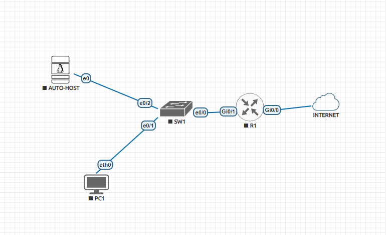

# Hybrid Cloud Connectivity Lab - On-Prem to Azure Site-to-Site VPN + Automation

> **Status: work in progress.** Phase 1 (on-prem network) is complete. Azure, the IPsec tunnel
> and Python/Netmiko automation follow in the next phases - see [Roadmap](#roadmap).

## Scenario

A small company is moving an internal application server to Microsoft Azure. Office users must
keep reaching it privately, without exposing the server to the internet. The goal is to build a
secure Site-to-Site connection between the office network and an Azure virtual network, verify it
end to end, and automate configuration backups and link monitoring for the on-prem equipment.

This is my second portfolio lab. The first one,
[enterprise-network-lab](https://github.com/njegosvasic/enterprise-network-lab), covers campus
design (VLANs, HSRP, STP, ASA, IKEv2 VPN). This one focuses on **hybrid cloud networking and
automation**.

## Topology (Phase 1 - on-prem)



| Node | Platform | Role |
|---|---|---|
| R1 | Cisco IOSv 15.9 | Edge router - WAN (DHCP), LAN gateway, PAT, SSH; IPsec endpoint in Phase 3 |
| SW1 | Cisco IOL L2 15.1 | Access switch, management on Vlan1 |
| PC1 | VPCS | Office user for end-to-end tests |
| AUTO-HOST | Ubuntu 22.04 | Automation host - Python, Netmiko, SSH |
| INTERNET | EVE-NG Management(Cloud0) | Internet access through the host (VMware NAT) |

## IP Addressing Plan

| Segment / device | Address | Notes |
|---|---|---|
| On-prem LAN | 192.168.10.0/24 | |
| R1 Gi0/1 (LAN gateway) | 192.168.10.1 | |
| SW1 Vlan1 (management) | 192.168.10.2 | |
| PC1 | 192.168.10.11 | |
| AUTO-HOST | 192.168.10.20 | Static (netplan) |
| R1 Gi0/0 (WAN) | DHCP | Private address behind NAT |
| Azure VNet *(Phase 2)* | 10.10.0.0/16 | Workload subnet 10.10.1.0/24, GatewaySubnet 10.10.255.0/27 |

## Phase 1 - What Was Built and Verified

- PAT on R1 for internet access from the LAN
- SSH-only management on R1 and SW1 (SSHv2, local accounts, idle timeout)
- Hardening basics: strongest available password hashing, unused ports shut down, PortFast + BPDU Guard on host ports
- Ubuntu automation host with static addressing, Python tooling and SSH access to both Cisco devices

**Verification:**

- All four nodes reach `8.8.8.8` and resolve DNS names
- `show ip nat translations` on R1 shows LAN hosts translated to the WAN address
- `ssh admin@192.168.10.1` and `ssh admin@192.168.10.2` from AUTO-HOST succeed

## Troubleshooting Highlights

Five real issues so far, each with symptom, investigation, root cause and fix in
[docs/troubleshooting-log.md](docs/troubleshooting-log.md). Two favourites:

- **No DHCP address on the WAN interface** - a static IP + ping test proved the fault was Layer 2,
  not DHCP: the EVE-NG cloud object had the wrong network type.
- **Switch ignores its default gateway** - the IOL L2 image routes by default, and a routing device
  ignores `ip default-gateway`. Fixed with `no ip routing`.

Design reasoning is in [docs/design-decisions.md](docs/design-decisions.md).

## Repository Structure

```
hybrid-cloud-connectivity-lab/
├── README.md
├── topology/
│   └── topology-phase1.png
├── configs/
│   ├── R1.cfg
│   ├── SW1.cfg
│   └── end-hosts.md            (PC1, AUTO-HOST netplan and SSH client config)
└── docs/
    ├── troubleshooting-log.md
    └── design-decisions.md
```

## Roadmap

| Phase | Scope | Status |
|---|---|---|
| 0 | Environment preparation (EVE-NG, images, automation host) | Done |
| 1 | On-prem network - R1, SW1, PC1, AUTO-HOST | Done |
| 2 | Azure foundation - VNet, subnets, NSG, VM (Azure CLI) | Planned |
| 3 | Route-based IPsec IKEv2 tunnel (VTI, NAT-T) to Azure VPN Gateway | Planned |
| 4 | Verification and failure testing | Planned |
| 5 | Python/Netmiko - config backup, tunnel health monitoring, config diff | Planned |
| 6 | eBGP over the tunnel (optional) | Planned |

> Passwords and secret hashes in `configs/` are replaced with `<REDACTED-FOR-PUBLIC-REPO>`.

## Lab Environment

| Category | Details |
|---|---|
| Platform | EVE-NG on VMware Workstation |
| Images | Cisco IOSv 15.9, Cisco IOL L2 15.1, VPCS, Ubuntu Server 22.04 |
| Cloud *(Phase 2+)* | Microsoft Azure |
| Automation *(Phase 5)* | Python 3.10, Netmiko |
